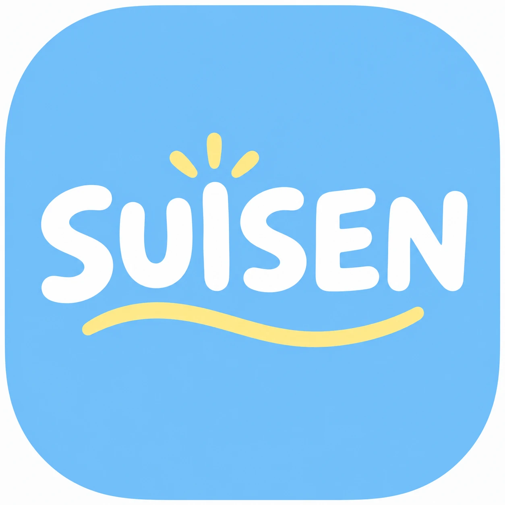

# SUISEN 基本設計書

作成: 2026-10-06

もとにする文書: [要件定義書](要件定義書.md)

この文書では、アプリの外から見た形（構成・画面・処理の流れ・データ）を決める。関数の作り、表の列の型、プロンプトの全文、計算式の細部は詳細設計書で決める。

## 1. システム構成

```
[学生の PC・スマホ（ブラウザ：HTML / CSS / JavaScript）]
        │ HTTP（学内ネットワーク）。画面の取得と、JSON でのやり取り
        ▼
[Webサーバー（PHP）] ──→ [MySQL]
        │                 
        ├──→ [学内LLM]  http://10.201.24.24:8200/v1（OpenAI互換）
        └──→ [Gmail SMTP]  smtp.gmail.com:587（確認コードの送信）
```

| 要素 | 使うもの | 役割 |
| --- | --- | --- |
| 画面 | React（TypeScript）、Motion | 画面の切り替えや吹き出し、診断結果の演出など、動きのある見た目にする（2026-10-13 に変更） |
| Webサーバー | PHP（Apache 上で動かす） | 画面の表示と、JavaScript から呼ばれる API（JSON を返す）。ログイン、LLM との会話、推薦と先輩検索の計算 |
| データベース | MySQL | 利用者、会話、診断結果、コースと先輩のデータを保存する |
| LLM | 北九州高専の学内 LLM | 会話の返事、会話からの特徴の取り出し、進路紹介の文章づくり |
| メール送信 | Gmail SMTP（アプリ専用の Gmail アカウント） | 確認コードを送る |

- アプリは学内ネットワーク上の PC 1台で動かす。サーバーには、Mac なら MAMP、Windows なら XAMPP を使う（Apache・PHP・MySQL）。
- 画面は React で作り、ビルドしたファイル（HTML・JavaScript・CSS）を MAMP・XAMPP の Apache から配る。Node.js が要るのはビルドする PC だけで、サーバーには要らない。
- 画面に出すデータ（ホームのステータス、会話の履歴など）も、操作（送信、診断など）も、すべて PHP の API と JSON でやり取りする。PHP は画面を作らない。
- 2026-10-13 に、動きのある見た目にするため、素の JavaScript から React に変えた。
- メール送信には PHP のライブラリ PHPMailer を使う。PHP 標準の `mail()` は Gmail の認証付き送信に対応していないため。

## 2. 画面設計

### 画面一覧

| ID | 画面 | 置くもの |
| --- | --- | --- |
| S1 | メールアドレス入力 | アプリの説明、メールアドレス入力欄、「確認コードを送る」ボタン（メール認証が無効のときは「ログイン」ボタン） |
| S2 | 確認コード入力 | 送信先のメールアドレス、確認コード入力欄、「ログイン」ボタン、「コードを送り直す」リンク |
| S3 | ホーム | ようこそのバナー（「新しい診断を始める」「続きから」）、あなたの診断結果（最も合うコース・最終診断・診断回数・「結果を見る」と、最新の診断の興味9項目のレーダーチャート）、5つのコースの紹介、ログアウト（2026-10-13 にチームメンバーの試作をもとに作り直し） |
| S4 | チャット | 会話の履歴、メッセージ入力欄、「送信」ボタン、「診断する」ボタン、「ホームへ」ボタン |
| S5 | 診断結果（2026-10-13 追加） | 最も合うコースとひとこと、興味のバランス（レーダーチャート）、学び方（棒グラフ）、AI のコメント、似た先輩の進路、北九州高専の進路実績、「もう一度診断する」「ホームへ」 |

### S3 ホームのステータス

| 項目 | 診断したことがある | まだ診断していない |
| --- | --- | --- |
| 最も合うコース | 最後の診断で最も合ったコース | 「まだ診断していません」 |
| 診断した日時 | 最後の診断の日時 | 表示しない |
| 診断した回数 | 回数 | 0回 |

- 要件定義書の F4 診断結果（最も合うコースの表示）は、このステータスで表示する。診断結果だけの画面は作らない。

### S4 チャットの動き

- 送信したメッセージはすぐに画面に出し、LLM の返事を待つ間は「考え中」の表示を出す。
- 「診断する」を押すと、診断中の表示を出し、終わったら S5 診断結果へ移る（2026-10-13 変更。前はチャットの中に結果を出していた）。
- 診断が終わった会話を開いたときは、入力欄の代わりに「結果を見る」を出す。

### S5 診断結果の演出

診断の直後は、結果を見るまでの流れを演出する。
1. **焦らし：** 「診断結果が出ました。」「あなたに合ったコースは…」と順に出て、「結果を見る」ボタンが脈打つ。
2. **ドラムロール：** 押すと画面が青くなり、「診断中…」が出る。
3. **結果：** コース名が弾んで出て、きらめきが散る。レーダーチャートと棒グラフが伸び、カードが順に浮かび上がり、数字が数え上がる。

ホームから見直すときは、1・2を飛ばして結果をすぐ出す。

### 画面の移り方

```
S1 メールアドレス入力 ──送信──→ S2 確認コード入力 ──正しいコード──→ S3 ホーム
                                                                    │  ↑
                                                新しい会話を始める・続きから  ホームへ
                                                                    ↓  │
                                                                 S4 チャット
```

- ログインしたままの状態（1週間以内）でアクセスしたら、S1 と S2 を飛ばして S3 を表示する。
- メール認証が無効のとき（2026-10-12 時点）は、S1 から S2 を通らずに S3 へ移る。
- ログアウトしたら S1 に戻る。

### デザインの方向



チームメンバーが作ったアイコンの雰囲気に合わせ、やさしく親しみやすい見た目にする。

- **名前の由来：** SUISEN は、花の「水仙」と「推薦」をかけている。
- **色：** アイコンの空色を基調にし、白とやわらかい黄色を差し色にする。
- **形：** 角を大きく丸めたカードとボタン、丸みのある文字。
- **アクセント：** アイコンの黄色い波線やきらめきのような、手描き風の飾りを控えめに使う。
- 細かい色の値やフォントは詳細設計で決める。

## 3. 機能設計

### F5 ログイン

メール認証は設定で有効・無効を切り替えられる。2026-10-12 時点では無効にしていて、1. でメールアドレスが正しければ、そのままログイン状態にする。以下は有効のときの流れ。

1. S1 でメールアドレスを受け取る。`@apps.kct.ac.jp` で終わらなければエラーを表示する。
2. 6桁の確認コードを作って保存し（有効期限10分）、Gmail SMTP で送る。
3. S2 で入力されたコードを照合する。
   - 正しければ、利用者がいなければ新しく登録し、ログイン状態にする。
   - 間違いが続いた場合は、そのコードを使えなくする（回数は詳細設計で決める）。
4. ログイン状態は1週間保つ。

### F1 チャット

1. S4 で学生のメッセージを受け取る。
2. これまでの会話と一緒に学内 LLM に送り、返事を受け取る。
3. メッセージと返事を保存して（F6）、S4 に表示する。
   - LLM とのやり取りが失敗したときは、どちらも保存しない（壊れた履歴を残さない）。

### F2 コース推薦・F3 進路紹介・F4 診断結果

「診断する」ボタンを押すと、次の順に処理する。

1. **特徴の取り出し：** 会話全体を LLM に渡し、学生の特徴（13項目）を決まった形（JSON）で返させる。
2. **コース推薦：** 学生の特徴と5コースの特徴を比べ、最も合うコースを決める（PHP で計算）。
3. **先輩検索：** 学生の特徴と先輩100人の特徴を比べ、似ている先輩を数人選ぶ（PHP で計算）。
4. **進路紹介：** 選んだ先輩の「進んだコース」と「進路」を LLM に渡し、紹介の文章を作らせる。
5. 推薦したコースと進路紹介の文章を、会話にも残し、診断結果としても保存する。S5 診断結果へ移り、S3 ホームのステータスも新しい診断結果に変わる。

### F6 会話の保存

- 学生のメッセージ、LLM の返事、診断結果を、利用者ごとに保存する。

### F7 資料の検索（RAG）

**準備（前もって1回）**

1. 高専 Web シラバスから、5コースの専門科目の詳細ページを取得する。
2. 科目ごとに「概要」と「授業計画」を取り出し、検索しやすい長さの断片（チャンク）に分ける。
3. 各チャンクを TF-IDF でベクトル（数値の並び）にし、検索用の索引として保存する。

**チャットでの使い方**

1. 学生のメッセージを受け取ったら、まず LLM に「検索が必要か」と「検索用のキーワード」を考えさせる（決まった形の JSON で返させる）。
2. 検索が必要なら、キーワードをベクトルにし、索引の中から近いチャンクを数件選ぶ。
3. 選んだチャンクを参考資料として会話用の指示に入れ、LLM に返事を作らせる。資料にないことは「分かりません」と答えさせる。
4. 返事と一緒に、参考にした科目名を画面に出す。

**診断での使い方**

- **推薦：** 推薦したコースの中から、学生の興味に関わる授業を検索し、推薦の文章に科目名を添える（テンプレートで作る）。
- **進路紹介：** 推薦したコースの中から、似た先輩の進路に関わる授業を検索し、進路紹介の指示に参考資料として入れる。

**ベクトルにする方法**

- TF-IDF（文字の出現回数と、その文字の並びがどれだけ珍しいかで重みを付ける方法）を使う。モデルが要らず、PHP だけで動く。
- 言い換えに弱い点は、1. で LLM に検索用のキーワードを考えさせて補う。
- ベクトルにする部分は1か所にまとめ、学内 LLM のサーバーで埋め込み（意味でベクトルにする機能）が使えると分かったら、そこだけ差し替えられるようにする。

## 4. チャットの進め方

| 項目 | 決めたこと |
| --- | --- |
| 会話の形 | LLM に自由に質問させる。役割の指示（システムプロンプト）で、13項目に関わる興味・得意なこと・学び方の好みを聞き出すように伝える |
| 診断に移る合図 | 学生が「診断する」ボタンを押す。ボタンは5往復を超えたら押せるようにする（それより前は情報が足りないため） |
| 診断の後 | その会話は終わりにして、入力欄を閉じる。やり直すときは「新しい会話」ボタンで新しい会話を始める。過去の会話と診断結果は保存したまま |

- 会話の最初は、LLM からのあいさつと最初の質問で始める。
- 進路と関係のない話題には、進路の話に戻すように答えさせる。
- 自由な会話なので、話題に出ない項目もありうる。特徴を取り出すときに話題に出なかった項目は、3（ふつう）とする。

## 5. 推薦と進路紹介の考え方

### 特徴の項目（13項目）

| 区分 | 項目 |
| --- | --- |
| 興味分野（9） | 力学・材料、熱・流体、設計・ものづくり、制御・ロボット、回路・電子、電力・電気機器、プログラミング・情報、化学、生物・食品 |
| 学び方（4） | 手を動かす、コード、理論、実験 |

- 学生と先輩は、各項目を5段階（1〜5）で表す。
- コースは、vault のコース分析ノートにある値（必修科目の単位の割合）を使う。

### 比べ方

- **学生とコース：** 相関係数で比べる。
  - 学生とコースの値は物差しが違う（5段階と割合）。相関係数は、それぞれの平均との差で比べるので、物差しの違いや「全体に高めに答える」癖の影響を受けにくい（vault の教訓）。
- **学生と先輩：** 同じ物差し（5段階）なので、相関係数か距離で比べる。どちらにするかは詳細設計で決める。
- 比べる計算は1か所にまとめ、将来、埋め込みによる検索などに差し替えられるようにする。

## 6. データ設計

| データ | 中身 | 関係 |
| --- | --- | --- |
| 利用者 | メールアドレス、登録日時 | — |
| 確認コード | メールアドレス、コード、有効期限、間違えた回数 | — |
| 会話 | 利用者、開始日時 | 利用者1人に会話が複数 |
| メッセージ | 会話、話し手（学生・LLM）、本文、日時 | 会話1つにメッセージが複数 |
| 診断結果 | 会話、学生の特徴（13項目）、最も合うコース、進路紹介の文章、日時 | 会話1つに診断結果1つ |
| コース | コース名、特徴（13項目） | 5件。シラバスの分析結果から作る |
| 先輩 | 進んだコース、特徴（13項目）、進路（就職・進学の別、行き先） | 100件。テストデータ |
| 検索の索引 | シラバスのチャンク（科目名、コース、本文）と、そのベクトル | DB ではなくファイルに保存する。シラバスから作り直せるため |

## 7. 外部とのつながり

### 学内 LLM

| 使い道 | 渡すもの | 受け取るもの |
| --- | --- | --- |
| 検索の計画 | 直前の会話と、学生のメッセージ | 検索が必要か、検索用のキーワード、関わるコース（JSON） |
| 会話の返事 | 役割の指示（検索で見つかった参考資料を含む）と、これまでの会話 | 返事の文章 |
| 特徴の取り出し | 会話全体 | 13項目の5段階の値（JSON。値は選択肢に縛る） |
| 進路紹介の文章 | 推薦したコース、似た先輩の進路、関わる授業の参考資料 | 紹介の文章 |

- `chat_template_kwargs: {enable_thinking: false}` を必ず付ける。
- 取り出した特徴は、保存の前に PHP で値の範囲を確かめる。
- つながらないときは「LLM に接続できませんでした」と表示し、何も保存しない。

### Gmail SMTP

- アプリ専用の Gmail アカウントとアプリパスワードで、確認コードのメールを送る。
- 送れなかったときはエラーを表示し、もう一度送れるようにする。
- アカウントとパスワードは設定ファイルに置き、画面には出さない。

## 8. セキュリティ

- 画面に出す文字は、利用者の入力も LLM の返事も、すべてエスケープする。
- SQL は、値を直接つながずにプレースホルダを使う。
- フォームには CSRF 対策のトークンを付ける。
- 確認コードの送信回数に上限を設ける（何度も送れないようにする）。
